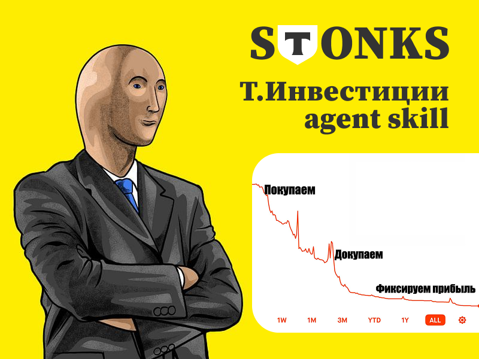

<p align="center">
  
</p>

<div align="center">

# T-Invest

**An AI agent skill with access to your T-Invest (Tinkoff Invest) brokerage account. Portfolio, returns, analytics and trades on your command through the T-Invest API.**

[](https://github.com/nyxandro/t-invest-skill/releases)
[](LICENSE)
[](https://agentskills.io/specification)
[](#install)


[Русский](README.md) · **English**

</div>

A skill for Claude Code, Codex, OpenCode, Cursor and other agents that read Agent Skills and can
run commands. You ask in plain words, the agent calls the bundled CLI and answers from your real
account data through the [T-Invest API](https://developer.tbank.ru/invest/api), not from memory.
You never run the CLI yourself.

It is **a tool for access to data and operations**, not an investment adviser. It gives no
investment advice and no individual investment recommendations. See the
[disclaimer](#disclaimer).

## What it does

| Area | What's inside |
|---|---|
| Portfolio | Positions and P/L, real return as XIRR with deposits and withdrawals, structure by asset class, sector, currency, country and concentration, a coupon and dividend calendar, free cash, operations with fees |
| Market and securities | Quotes, price history against the IMOEX benchmark, order book, recent trades, RSI, SMA and MACD indicators, trading schedules, asset cards, bonds with YTM and duration, dividends, fundamentals, analyst forecasts |
| Screeners | Bonds by YTM, term and risk, stocks by fundamentals, across the whole reference list with a local cache |
| News and events | News, insider deals, the earnings calendar, strategy signals, a watchlist |
| Trading | Orders and stop orders. Free in the sandbox, each real trade confirmed on the live account, blocked by code in read-only mode |

The CLI computes bond yield to maturity, duration and the account's XIRR itself, because the
T-Invest API doesn't return them. For floaters, amortizing and perpetual bonds YTM stays empty
with the reason.

## Install

You need **Node.js 20 or newer**. It's the only external dependency. All the code is bundled into
one file, with no npm packages and no build step.

| Way | Command |
|---|---|
| Claude Code, as a plugin | `/plugin install t-invest --marketplace nyxandro/skills` |
| Claude Code, Codex, OpenCode, Cursor and others | `npx skills add nyxandro/t-invest-skill` |
| One command, Linux, macOS, WSL | `curl -fsSL https://raw.githubusercontent.com/nyxandro/t-invest-skill/main/install.sh \| bash` |
| By hand | Download the [latest `.skill` archive](https://github.com/nyxandro/t-invest-skill/releases/latest/download/t-invest.skill) and unpack it into the agent's skills folder |

Pick one. If you install it two ways, Claude Code loads the skill twice. Restart the agent's
session after installing.

<details>
<summary>More about the install options</summary>

<br>

- `install.sh` downloads the skill, puts it into `~/.agents/skills/` and `~/.claude/skills/`, and
  creates an `~/.config/tinvest/.env` template with no tokens. Running it again updates the skill
  and leaves the tokens you entered alone.
- The plugin and `npx skills` don't create the `.env` template. Create it as shown in
  [Tokens and modes](#tokens-and-modes).
- The `.skill` archive is a ZIP. Unpack it into the skills folder, the agent doesn't pick up the
  archive file itself.

  ```bash
  unzip t-invest.skill -d ~/.agents/skills/     # or -d ~/.claude/skills/ for Claude Code
  ```

- The one-line plugin install needs Claude Code 2.1.275 or later. On an older version, add the
  catalog first with `/plugin marketplace add nyxandro/skills`.
- With `npx skills`, add `-g` to install the skill for every project. To install a given version,
  add its tag, as in `nyxandro/t-invest-skill@v1.1.0`.
- The skill tells you in `session status` when a new version appears in the repository.

</details>

## Usage

Ask as you normally would.

- *How's my portfolio?*
- *What did I pay for Sber?*
- *What's the yield on my bonds?*
- *Find bonds maturing within three years with a higher yield.*
- *When are the next coupons and dividends?*
- *Buy 10 lots of Sber at market.* On the live account the agent shows the order first and asks
  you to confirm.

At the start of every conversation the skill asks which mode to work in. The default is
`readonly`, the safest one.

## Tokens and modes

Each mode has its own token.

| Mode | Variable | What it is |
|---|---|---|
| `sandbox` | `T_INVEST_TOKEN_SANDBOX` | The sandbox, a virtual account with virtual money on a separate API endpoint |
| `readonly` | `T_INVEST_TOKEN_READONLY` | The live account, read only, no trades possible |
| `full` | `T_INVEST_TOKEN_FULL` | The live account with real trades, off by default |

Tokens are issued in your [T-Invest account settings](https://www.tbank.ru/invest/settings/), under
"T-Invest API tokens". There is a
[step-by-step guide](https://developer.tbank.ru/invest/intro/intro/token). They go into one file,
`~/.config/tinvest/.env`.

```bash
mkdir -p ~/.config/tinvest
cat > ~/.config/tinvest/.env <<'EOF'
T_INVEST_TOKEN_SANDBOX=      # sandbox
T_INVEST_TOKEN_READONLY=     # live account, "View only" level
T_INVEST_TOKEN_FULL=         # live account, "Trading" level (NOT "Trading and transfers")
EOF
chmod 600 ~/.config/tinvest/.env
```

Fill in only the modes you need. The CLI reads `.env` only from `~/.config/tinvest/.env`, never
from the current folder, so it works the same from any directory. Real environment variables take
priority over the file, which is the standard way for CI and containers. Without a token you get
`APP_TINVEST_TOKEN_MISSING`, there are no defaults. The "Trading and transfers" level is **not
needed**, because the CLI never transfers or withdraws money.

## Real money

A full token on its own does **not** allow trading. Real trades are turned on by a flag in the
environment, and each one needs confirmation. These steps are checked in code before any API
call.

| Mode or flag | What happens |
|---|---|
| `readonly` | Any trade is refused, `APP_TINVEST_TRADING_FORBIDDEN` |
| `sandbox` | Virtual trades are free |
| `full` without the flag | Read only, a trade gives `APP_TINVEST_TRADING_DISABLED` |
| `full` with `T_INVEST_ALLOW_TRADING=true` | A trade needs `--confirm`, otherwise `APP_TINVEST_CONFIRM_REQUIRED` |
| `full` with `T_INVEST_STONKS_MODE=true` | **Dangerous.** Trades without confirmation, fully autonomous |

What protects the money.

- **Every trade is confirmed.** The agent adds `--confirm` only after you've explicitly agreed to a
  specific order.
- **A liquidity check.** Before a real market order it checks the order book and the spread. On an
  illiquid security or a wide spread the order is blocked and the agent suggests a limit order.
- **An idempotency key** (`--order-id`) keeps an order from being placed twice when a request is
  retried after a network failure.
- **A trade log.** Every operation, real or in the sandbox, is appended to
  `~/.config/tinvest/trades.log` with the time, mode, security, lots, price and order number.

**Money can't leave the account.** A "Trading" level token and no transfer or withdrawal methods in
the code leave only operations with securities inside the account. To be honest about it, the mode
split and the trading flag protect the normal paths, they aren't cryptography. Whoever controls the
environment can turn the flag on, but that's a deliberate act.

<details>
<summary>How it works inside</summary>

<br>

- **The active mode is remembered.** At the start of every conversation the skill asks for the mode
  and overwrites the choice, so a new run or another session never inherits it silently. The memory
  is a convenience within a conversation and survives a lost context, while `session status` is the
  source of truth. Until the mode is confirmed, data commands don't run
  (`APP_TINVEST_SESSION_REQUIRED`). Switch at any time with `session start --mode <mode>`.
- **Several agents at once.** If several agents work under one user at the same time, give each its
  own `TINVEST_SESSION_ID` so their modes don't overwrite each other. One agent doesn't need it.
- **Cache.** Instrument lists are kept for a day and coupon schedules for a week, in
  `~/.config/tinvest/cache`. After the first run, screeners and portfolio structure take a fraction
  of a second. The cache is safe to delete entirely.
- **Errors.** Every error comes in Russian with a stable `APP_TINVEST_...` code. Technical details
  appear when you run with `TINVEST_DEBUG=1`.
- **Rules for the agent** (modes, trade confirmation, due diligence, reading the JSON fields) live in
  `SKILL.md` and `references/` inside the package, and the agent must follow them.

</details>

## Versions

The current version is in `package.json` and in the header of `skills/t-invest/SKILL.md`. Every
version has a git tag and a [release](https://github.com/nyxandro/t-invest-skill/releases) with
the skill archive. [CHANGELOG.md](CHANGELOG.md) lists what changed, in Russian.

## Disclaimer

This is a tool for access to data and operations of the T-Invest API. It **is not an investment
advisory service and gives no individual investment recommendations**. Data and calculations are
provided "as is", for information. All investment decisions and trades are at the user's
discretion and responsibility. Analytics (returns, screeners, analyst forecasts) are data and
calculations, not recommendations to buy or sell.

## License

[MIT](LICENSE)
